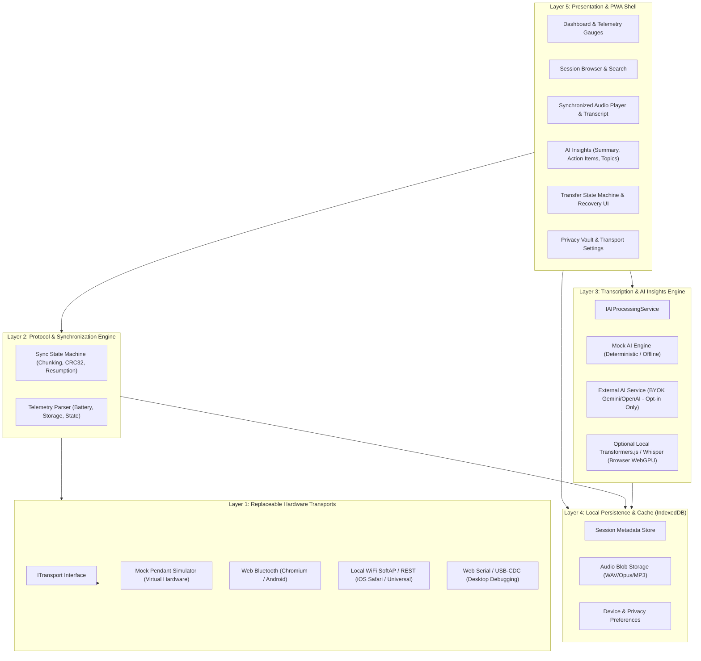

# Ambient Memory Pendant: Architecture, Data Models & Staged Implementation Plan

## 1. Executive Summary & Repository Audit

The **Ambient Memory Pendant** is a wearable ambient capture device powered by an ESP32-C3 Super Mini micro-controller, an integrated microphone, and local microSD card storage. It captures voice memos, meetings, lectures, and ambient memories offline, preserving raw audio safely on physical media before synchronizing to the user's companion interface.

### Audit Findings
- **Initial Repository State**: Empty directory (`c:\Users\ASHIK\Desktop\Project irfan`).
- **Baseline Framework Decision**: Initializing a clean, modern **React + Vite + TypeScript** progressive web application.
- **Design Philosophy**: High-fidelity, modern dark-mode aesthetic with bespoke CSS tokens (slate/obsidian dark substrate, titanium borders, luminous cyan/emerald telemetry accents, subtle glassmorphism), fluid animations, and mobile-first responsive layout (installable PWA).
- **Core Principle**: **Software-first, hardware-ready**. We model real-world hardware states (including uncalibrated telemetry, disconnection drops, packet retransmits, and iOS WebKit constraints) without inventing unverified pinouts or fabricating fake measurements.

---

## 2. System Architecture

The application is structured into decoupled, single-responsibility modules:



---

## 3. Hardware Reality & Platform Constraints

### 3.1 The ESP32-C3 Super Mini
- **Architecture**: Single-core 32-bit RISC-V at up to 160 MHz with integrated 2.4 GHz Wi-Fi and Bluetooth 5 (LE).
- **Pinout Caution**: The ESP32-C3 Super Mini has limited exposed GPIOs (typically GPIO 0 to 10, plus 20/21 USB). GPIO assignments for SPI microSD (CS, MOSI, MISO, SCK) and I2S/PDM microphone (BCLK, WS, DATA_IN) depend strictly on the physical breakout and board rev.
  - *Rule*: We do **not** hardcode or fabricate fixed GPIO numbers in firmware drafts. All pinouts are defined in a configuration profile (`HardwareProfile`) pending physical hardware verification.
- **Battery & Telemetry Rules**:
  - Super Mini boards lack an onboard LiPo fuel gauge IC (like MAX17048) by default. If battery measurement is wired via an ADC voltage divider (e.g. GPIO 0 / 1 / 2), voltage calibration is required.
  - Telemetry contract: Battery percentage is typed as `number | null`. If uncalibrated or unmeasured, the UI explicitly renders **"Uncalibrated / Unknown"** rather than a fabricated "100%".
- **MicroSD Data Safety**:
  - The microSD card is the **source of truth**.
  - A recording on microSD is **never** deleted automatically upon transfer start.
  - It is only marked `SYNCHRONIZED` (or purged if user explicitly enables auto-delete) after:
    1. All binary chunks are received.
    2. Checksum (CRC32/SHA256) matches the header.
    3. The file is durably committed to browser IndexedDB storage.
    4. An explicit confirmation ACK is returned to the pendant.

### 3.2 The iOS Safari Web Bluetooth Dilemma
- **The Problem**: Apple Safari (and all WebKit browsers on iOS) does **not** support the W3C Web Bluetooth API.
- **The Solution Architecture**:
  1. **Primary BLE Mode**: Available on Chromium-based browsers (Chrome on Android, Edge/Chrome on Windows/Mac/Linux).
  2. **SoftAP / Local WiFi HTTP Transport**: The ESP32-C3 can launch a low-power WiFi SoftAP (e.g. `AmbientPendant-XXXX`) or connect to the local home WiFi. The PWA can fetch recordings directly over `http://pendant.local/api/recordings` or WebSockets. This works 100% reliably in iOS Safari!
  3. **Universal Mock / Offline Mode**: Instant test and demonstration without requiring any live hardware.

---

## 4. Typed Data Models

### 4.1 Device Status & Telemetry
```typescript
export type ConnectionState = 'disconnected' | 'connecting' | 'connected' | 'reconnecting' | 'error';
export type DeviceOperatingMode = 'idle' | 'recording' | 'syncing' | 'low_power' | 'error';

export interface BatteryTelemetry {
  /** Battery level in percent (0-100), or null if uncalibrated/unmeasured */
  percentage: number | null;
  /** Millivolts measured at ADC divider, or null if unmeasured */
  voltageMv: number | null;
  /** True if external charging voltage detected, null if unknown */
  isCharging: boolean | null;
}

export interface StorageTelemetry {
  /** Total microSD capacity in bytes, or null if card missing/unmeasured */
  totalBytes: number | null;
  /** Used storage in bytes */
  usedBytes: number | null;
  /** Estimated recording minutes remaining at current bit rate */
  estimatedMinutesRemaining: number | null;
  /** Card status flag */
  status: 'mounted' | 'missing' | 'write_error' | 'unformatted';
}

export interface PendantDeviceStatus {
  deviceId: string;
  hardwareRevision: string;
  firmwareVersion: string;
  connectionState: ConnectionState;
  operatingMode: DeviceOperatingMode;
  battery: BatteryTelemetry;
  storage: StorageTelemetry;
  clock: {
    deviceRtcTimestampMs: number | null;
    isClockSynchronized: boolean;
  };
  activeRecordingId: string | null;
  activeRecordingDurationSec: number;
  lastSyncTimestampMs: number | null;
}
```

### 4.2 Recording Sessions & AI Insights
```typescript
export interface AudioMetadata {
  format: 'wav' | 'pcm' | 'opus' | 'mp3';
  sampleRateHz: number;
  channels: 1 | 2;
  bitDepth?: 16 | 24 | 32;
  durationSeconds: number;
  fileSizeBytes: number;
  checksumSha256: string;
  filename: string;
}

export interface TranscriptWord {
  word: string;
  startMs: number;
  endMs: number;
}

export interface TranscriptSegment {
  id: string;
  speakerLabel?: string;
  startMs: number;
  endMs: number;
  text: string;
  words?: TranscriptWord[];
}

export interface ActionItem {
  id: string;
  description: string;
  completed: boolean;
  assignedTo?: string;
  dueSuggestion?: string;
  sourceTimestampMs?: number;
}

export interface AIAnalysis {
  provider: 'local_mock' | 'cloud_gemini' | 'cloud_whisper' | 'webllm_local';
  isDemonstrationData: boolean;
  analyzedAtMs: number;
  executiveSummary: string;
  importantTopics: string[];
  keyConcepts: Array<{ term: string; explanation: string }>;
  thingsToRemember: string[];
  actionItems: ActionItem[];
  studyQuestions: Array<{ question: string; answerSummary: string }>;
  sentiment?: 'reflective' | 'action_oriented' | 'analytical' | 'neutral' | 'urgent';
}

export interface RecordingSession {
  id: string;
  title: string;
  capturedAtMs: number;
  pendantDeviceId: string;
  metadata: AudioMetadata;
  transcript: TranscriptSegment[];
  insights: AIAnalysis;
  audioBlobUrl?: string; // Loaded from IndexedDB
  syncStatus: 'pendant_only' | 'syncing' | 'synced_local' | 'sync_failed';
  transferProgressPercent?: number;
  tags: string[];
  notes?: string;
}
```

### 4.3 Transfer Protocol & Chunking
```typescript
export interface TransferPacket {
  sessionId: string;
  chunkIndex: number;
  totalChunks: number;
  chunkSizeBytes: number;
  payload: Uint8Array;
  chunkCrc32: number;
}

export interface TransferState {
  sessionId: string;
  status: 'idle' | 'in_progress' | 'paused' | 'verifying' | 'completed' | 'failed';
  totalBytes: number;
  transferredBytes: number;
  currentChunk: number;
  totalChunks: number;
  bytesPerSecond: number;
  estimatedRemainingSec: number;
  retryCount: number;
  errorMessage?: string;
}
```

---

## 5. Firmware Communication Protocol Draft

To allow straightforward ESP32-C3 firmware implementation later, communication uses lightweight framing over BLE GATT or HTTP REST.

### BLE GATT Service Architecture (Chromium/Android)
- **Service UUID**: `0000FE60-0000-1000-8000-00805F9B34FB` *(Reserved custom 128-bit base)*
  - **Char: Device Telemetry (Notify/Read)**: `...FE61` - Emits 16-byte packed telemetry frame (battery, storage %, state).
  - **Char: Command / Control (WriteWithResponse)**: `...FE62` - Send commands (`START_RECORD`, `STOP_RECORD`, `SYNC_SESSION_LIST`, `REQUEST_CHUNK`, `ACK_TRANSFER`).
  - **Char: Data Transfer Stream (Notify)**: `...FE63` - Streams binary chunks with 4-byte index + payload + 4-byte CRC32.

### HTTP REST / WebSocket Architecture (iOS Safari / Universal WiFi)
- `GET /api/status` -> JSON telemetry payload.
- `GET /api/sessions` -> List of session manifests stored on microSD.
- `GET /api/sessions/:id/stream` -> Standard HTTP range-request audio stream.
- `POST /api/sessions/:id/ack` -> Confirms sync completion; sets safe microSD flag.

---

## 6. Privacy & AI Transparency

1. **Local-First Default**: By default, no audio is sent anywhere. Everything remains stored inside the browser's IndexedDB.
2. **Clear Badging**: Every insight or transcript is explicitly tagged:
   - 🟢 `PROCESSED LOCALLY (MOCK / DEMO)`
   - 🔵 `PROCESSED BY USER AI API (GEMINI / OPENAI)`
3. **Explicit Consent**: External cloud processing requires user configuration and active opt-in. Audio is never dispatched without explicit user trigger.

---

## 7. Staged Implementation Plan

| Stage | Objective | Deliverables | Verification Strategy |
|---|---|---|---|
| **Stage 1** | Project Scaffolding & Setup | Vite + React + TS, Manifest, Service Worker, Vanilla CSS Design System | Build verification, PWA audit, dev server running |
| **Stage 2** | Data Models & Transport Architecture | Interfaces (`types/`), `ITransport`, `MockPendantService`, `SyncManager` | Unit test / type-check coverage |
| **Stage 3** | IndexedDB & Audio Synthesizer | IndexedDB layer for blobs/metadata, Web Audio generator producing realistic spoken audio tones/waves | Playback test without external audio assets |
| **Stage 4** | Shell, Navigation & Telemetry Dashboard | Mobile & desktop layout, battery/storage gauges, hardware telemetry, connection drawer | Visual and responsive layout verification |
| **Stage 5** | Mock Device & Transfer State Machine | Interactive hardware simulator: record toggle, battery drain, connection drop, chunked transfer with resume | Verify transfer recovery and checksum match |
| **Stage 6** | Sessions, Audio Player & Timestamped Transcript | Interactive waveform/scrubber, transcript auto-scroll, search filters, speaker tags | Playback & transcript sync test |
| **Stage 7** | AI Insights Engine & Action Items | Executive summary, topic pills, actionable task list with checkboxes and clipboard export | User review and export verification |
| **Stage 8** | Settings, Privacy Controls & iOS Transport Guide | Local-first switches, BLE vs WiFi selector, microSD safety controls, protocol documentation | Interactive walkthrough & testing |
